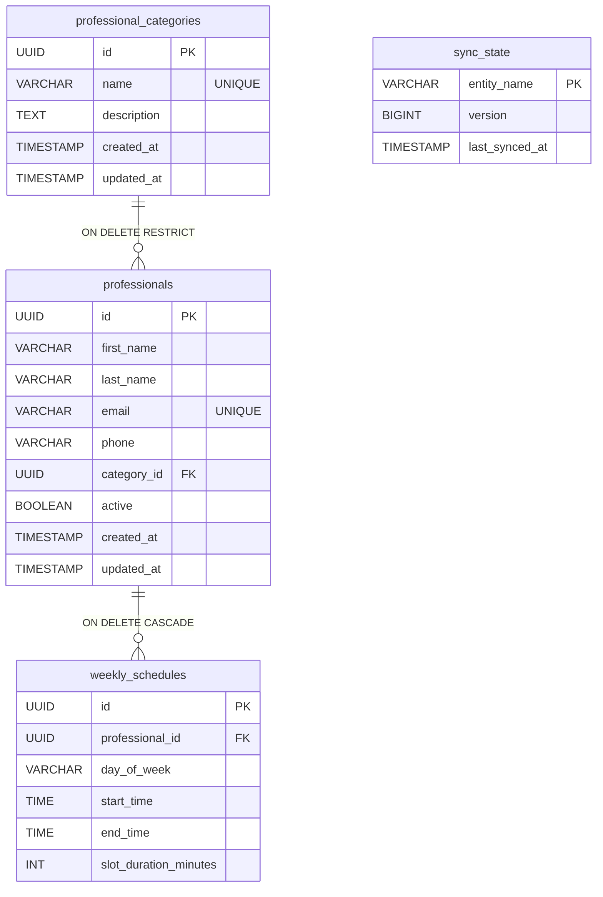

# Esquema de Base de Datos - Módulo Catálogo (Versión 1)

## Modelo de Datos - Catálogo (v1)

---

## Tablas principales

* **`professional_categories`:** Almacena las distintas categorías y especialidades que agrupan a los profesionales.
* **`professionals`:** Registra la información personal, estado y vías de contacto de cada profesional, vinculándose a una categoría.
* **`weekly_schedules`:** Define las franjas horarias semanales y la duración de turnos asignadas a cada profesional.
* **`sync_state`:** Lleva el control de versiones y marcas temporales de sincronización con otros módulos.
*ay para versionar y auditar la ejecución de las migraciones SQL.

