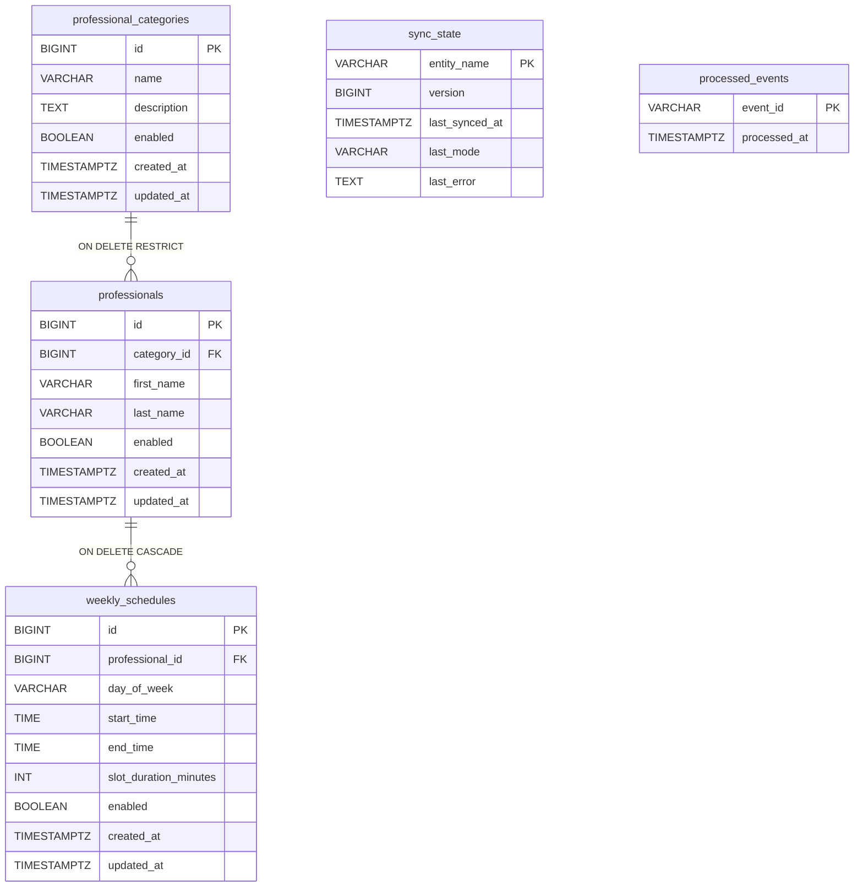

# Esquema de Base de Datos - Módulo Catálogo (Versión 2)

Base PostgreSQL, propiedad exclusiva de service-catalog. Migraciones Flyway: V1 (esquema inicial),
V2 (alineación con el contrato de cátedra v1) y V3 (eventos procesados y fila inicial de sync_state).

## Tablas principales
- `professional_categories`: categorías de profesionales publicadas por la cátedra.
- `professionals`: profesionales, vinculados a una categoría. No guarda datos de contacto: el contrato no los define.
- `weekly_schedules`: franjas horarias semanales y duración del turno de cada profesional. Restricciones: inicio menor que fin, duración positiva y día de la semana válido.
- `sync_state`: una única fila `CATALOG` con la versión global del catálogo aplicada, el modo de la última sincronización (SNAPSHOT o INCREMENTAL) y el último error. Se bloquea con SELECT ... FOR UPDATE para serializar las sincronizaciones.
- `processed_events`: eventIds de Kafka ya procesados.

## Reglas
- Los IDs los asigna la cátedra; nunca se generan localmente.
- Las entidades deshabilitadas se conservan con `enabled = false` (baja lógica).
- Los timestamps vienen de la cátedra, sin valor por defecto.
- El snapshot reemplaza toda la copia en una transacción; el incremental hace upsert por versión.
- `last_error` está reservado para registrar fallos de sincronización (se completa con la reconciliación periódica).