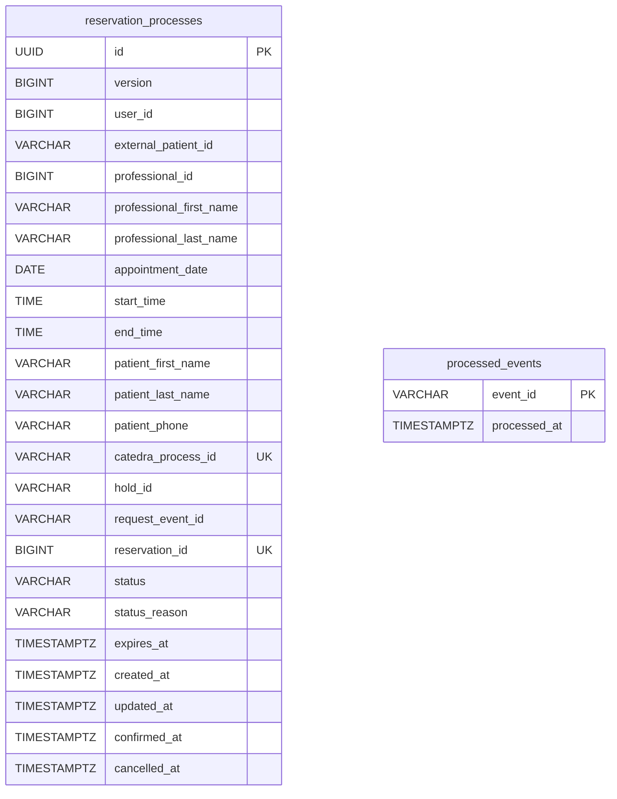

# Esquema de Base de Datos - service-turns (Versión 1)

Base PostgreSQL propia de service-turns, con su propio usuario y sus propias migraciones (Flyway). service-catalog no
accede a ella ni ella a la de service-catalog.

## Tablas
- `reservation_processes`: el proceso de reserva de un usuario, desde que inicia hasta que queda confirmado, cancelado,
  vencido, inválido o fallido. Una reserva confirmada es una fila en estado CONFIRMED.
- `processed_events`: eventos de Kafka ya procesados, para descartar los repetidos.

## Reglas
- `user_id` es el dueño y sale del token. Las consultas siempre filtran por él.
- Los datos del profesional (nombre y apellido) son históricos, no el catálogo vigente.
- Restricciones: estados válidos, `end_time` posterior a `start_time`, identificadores de la cátedra pasado el estado STARTED,
  `reservation_id` en CONFIRMED y CANCELLED, y teléfono y `request_event_id` en PHONE_SUBMITTED.
- Índice único parcial: un solo CONFIRMED por profesional, fecha y hora de inicio.
- `version` implementa el bloqueo optimista.