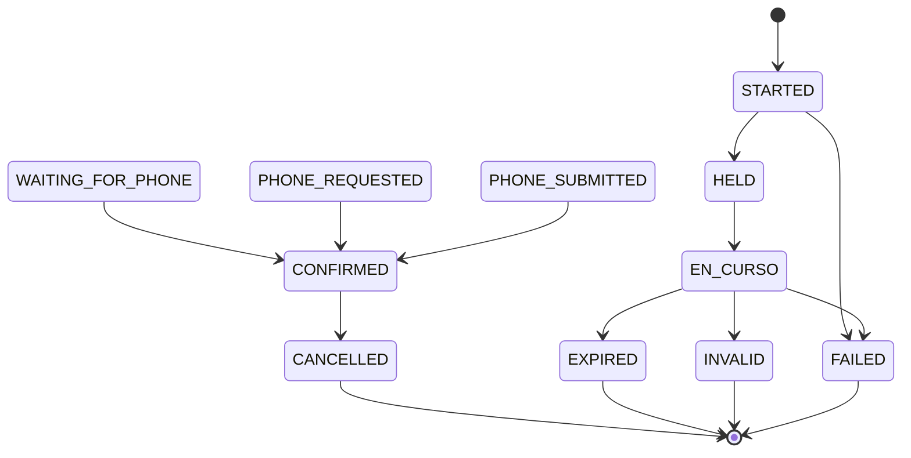

# Máquina de estados del proceso de reserva

Desde cualquier estado en curso (HELD, WAITING_FOR_PHONE, PHONE_REQUESTED, PHONE_SUBMITTED y PHONE_REJECTED) el proceso
puede pasar a EXPIRED, INVALID o FAILED. Los estados finales no tienen salida. CONFIRMED solo admite CANCELLED.