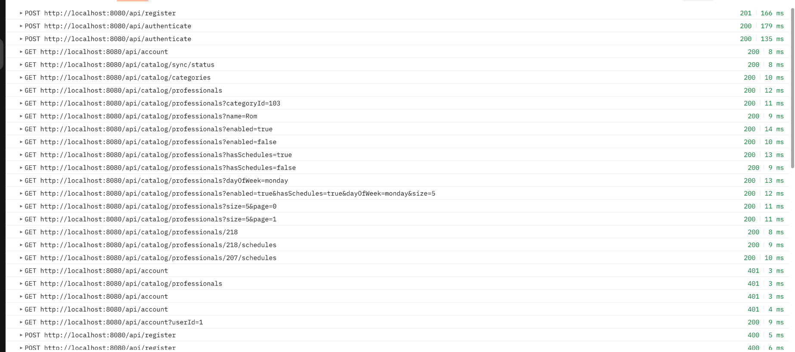
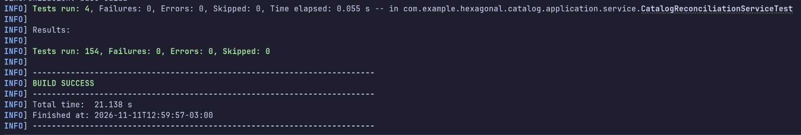

# Evidencias de service-catalog

## Pruebas de la API con Postman
Colección ejecutada con el Runner: todas las peticiones y verificaciones en verde.
Cubre el registro y la autenticación, la búsqueda con filtros sobre datos locales, el rechazo de accesos no autenticados y el manejo de errores.

La colección está en [specs/postman](../../specs/postman/).

## Pruebas automatizadas
